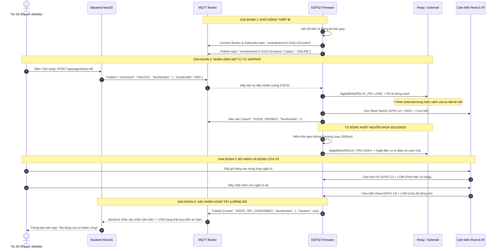

# Kế Hoạch Triển Khai Chức Năng Gửi Hàng Phần Cứng (Hardware Drop-off Implementation Plan)

> **Dự án:** Smart Locker System (Hệ thống Tủ Đồ Thông Minh)  
> **Module:** IoT Hardware Controller (`smart-locker-iot`)  
> **Thiết bị:** ESP32 DevKit V1 + Relay Module + Khóa Solenoid 12V + Cảm biến Reed & IR  
> **Giao thức:** MQTT over TCP (WiFi)  
> **Mục tiêu:** Nhận lệnh mở ngăn tủ từ Backend khi Shipper gửi hàng, kích hoạt chốt khóa, giám sát cảm biến đóng cửa và báo trạng thái realtime.

---

## 1. TỔNG QUAN KIẾN TRÚC PHẦN CỨNG

```mermaid
graph TD
    subgraph "1. Cloud & Backend"
        App["Mobile App Shipper"] -->|HTTP POST /packages/drop-off| Nest["NestJS Backend"]
        Nest -->|MQTT Publish lệnh UNLOCK| Broker["MQTT Broker (broker.emqx.io:1883)"]
    end

    subgraph "2. Bộ Điều Khiển Trung Tâm (ESP32 Controller)"
        Broker <-->|WiFi / MQTT Pub-Sub| ESP32["ESP32 DevKit V1 (Main Controller)"]
        ESP32 -->|GPIO Output (Active LOW)| Relay["Module Relay 5V Opto-isolated"]
        ESP32 <--|GPIO Input (Pull-up)| Reed["Cảm biến từ Reed Switch (Cửa Đóng/Mở)"]
        ESP32 <--|GPIO Input (Digital)| IR["Cảm biến quang hồng ngoại IR (Có hàng/Trống)"]
    end

    subgraph "3. Chấp Hành Vật Lý (Physical Locker Units)"
        Relay -->|Đóng ngắt nguồn 12V DC| Solenoid["Khóa điện từ Solenoid 12V (Bung chốt)"]
        Relay -->|Bật sáng| LED["Đèn LED chỉ dẫn ngăn tủ"]
    end
```

---

## 2. SƠ ĐỒ ĐẤU NỐI CHÂN PHẦN CỨNG (PINOUT MAPPING)

Tủ có 3 ngăn (số ngăn 1, 2, 3 tương ứng cỡ S, M, L). Bảng chân khai báo trong `src/config/Config.h` (`BOXES[]`). Relay là **Active HIGH** (mức `HIGH` cấp điện mở khóa, jumper relay đặt ở H).

| Ngăn | Relay `IN` | Reed (cửa đóng = LOW) | IR `OUT` (có hàng = LOW) |
| :--- | :--- | :--- | :--- |
| 1 (S) | IN1 ← **GPIO 13** | **GPIO 32** | **GPIO 35** |
| 2 (M) | IN2 ← **GPIO 14** | **GPIO 33** | **GPIO 34** |
| 3 (L) | IN3 ← **GPIO 27** | **GPIO 25** | **GPIO 36** (SP) |

Kênh nối với ESP32-CAM: ESP32 chính `GPIO 16` (trigger) tới `GPIO 13` của cam, `GPIO 17` (status) từ `GPIO 12` của cam.

| Linh kiện | Chân trên linh kiện | Nối với | Ghi chú kỹ thuật |
| :--- | :--- | :--- | :--- |
| **Relay Module** | `VCC` / `GND` | `VIN` (5V) / `GND` | Bắt buộc chung GND với nguồn 12V; nếu ESP32 reset khi khóa hút thì cấp nguồn 5V riêng |
| **Khóa Solenoid** (mỗi ngăn) | Dây dương (+) | `NO` của kênh relay tương ứng | `COM` của relay nối cực (+) nguồn 12V; dây âm (-) nối GND; thêm diode chống ngược song song cuộn hút |
| **Reed Switch** (mỗi ngăn) | `DO` | GPIO ở bảng trên, `INPUT_PULLUP` | Cửa đóng = nam châm hút = `LOW`; cửa mở = `HIGH` |
| **Cảm Biến IR** (mỗi ngăn) | `OUT` | GPIO ở bảng trên, `INPUT` | GPIO 34, 35, 36 chỉ là đầu vào, không có pull-up nội nên cần module tự kéo mức (hoặc thêm 10 kΩ lên 3V3) |
| | `VCC` / `GND` | `3V3` / `GND` | Chỉnh biến trở trên cảm biến để đạt cự ly 15-20cm |

---

## 3. THIẾT KẾ GIAO THỨC MQTT & BẢN TIN (MQTT TOPIC & PAYLOAD SPEC)

### 3.1. Cấu hình Broker
* **Host:** `broker.emqx.io` (hoặc Mosquitto IP nội bộ)
* **Port:** `1883`
* **Client ID:** `ESP32_LOCKER_S101_01`

### 3.2. Topic Lắng Nghe Lệnh Mở Tủ (Subscribed Topic)
* **Topic:** `smartlocker/LK-S101-01/control`
* **Payload từ Backend gửi xuống:**
```json
{
  "command": "UNLOCK",
  "boxNumber": 1,
  "durationMs": 2500,
  "requestId": "req_88392019"
}
```

### 3.3. Topic Báo Cáo Trạng Thái Phần Cứng (Published Topic)
* **Topic:** `smartlocker/LK-S101-01/status`
* **Khi khởi động (Heartbeat / Online):**
```json
{
  "device": "LK-S101-01",
  "status": "ONLINE",
  "ip": "192.168.1.120",
  "uptime": 12
}
```
* **Khi mở cửa thành công (Door Opened):**
```json
{
  "device": "LK-S101-01",
  "event": "DOOR_OPENED",
  "boxNumber": 1,
  "doorStatus": "OPEN",
  "timestamp": 1726200100
}
```
* **Khi bưu phẩm đã vào tủ & đóng cửa kín (Drop-off Completed):**
```json
{
  "device": "LK-S101-01",
  "event": "DROP_OFF_CONFIRMED",
  "boxNumber": 1,
  "doorStatus": "CLOSED",
  "hasItem": true,
  "timestamp": 1726200125
}
```

---

## 4. QUY TRÌNH HOẠT ĐỘNG CHI TIẾT TỪNG BƯỚC (STEP-BY-STEP FLOW)



---

## 5. CẤU TRÚC CODE FIRMWARE ESP32 (`smart-locker-iot`)

### 5.1. Thư viện phụ thuộc (`platformio.ini`)
```ini
[env:esp32dev]
platform = espressif32
board = esp32dev
framework = arduino
monitor_speed = 115200
upload_speed = 115200

lib_deps =
    knolleary/PubSubClient @ ^2.8
    bblanchon/ArduinoJson @ ^7.0.4
```

### 5.2. Các Module Code Chính Trong `src/`
1. **`Config.h`**: Định nghĩa SSID, Password WiFi, Broker IP/Port, gán chân GPIO Relay/Sensors.
2. **`MqttHandler`**: Quản lý kết nối, tự động reconnect khi mất mạng, xử lý gói tin JSON nhận được.
3. **`HardwareController`**:
   - Điều khiển Relay dạng **Non-blocking (sử dụng `millis()` thay cho `delay()`)** để ESP32 không bao giờ bị đơ khi đang mở cửa.
   - Hàm đọc cảm biến Reed switch kèm bộ lọc chống rung tiếp điểm (Debounce 50ms).
   - Hàm đọc cảm biến hồng ngoại IR lọc nhiễu ánh sáng môi trường.

---

## 6. LỘ TRÌNH TRIỂN KHAI PHẦN CỨNG THEO TỪNG BƯỚC

### Bước 1: Chuẩn Bị & Đấu Nối Phần Cứng (Hardware Wiring)
- Đấu nối dây tín hiệu từ ESP32 sang Relay Module (GPIO 13).
- Cấp nguồn 12V qua tiếp điểm thường mở (NO) của Relay tới khóa Solenoid.
- Lắp công tắc từ Reed Switch trên mép cửa tủ và nối về GPIO 14.
- Đặt cảm biến IR ở đáy ngăn tủ hướng lên hoặc ngang để quét bưu kiện, nối về GPIO 27.

### Bước 2: Nâng Cấp Firmware ESP32
- Thêm thư viện `PubSubClient` và `ArduinoJson` vào `platformio.ini`.
- Viết logic kết nối WiFi và MQTT Client trong `src/main.cpp`.
- Nạp code xuống ESP32 qua PlatformIO Upload.
- Mở Serial Monitor kiểm tra dòng log: `[WIFI] Connected!`, `[MQTT] Broker Connected!`.

### Bước 3: Tích Hợp `MqttModule` Phía Backend NestJS
- Cài `mqtt` trong thư mục `server`: `npm install mqtt`.
- Tạo `MqttService` để phát bản tin `UNLOCK` khi API `POST /packages/drop-off` được gọi.

### Bước 4: Chạy Thử Nghiệm Thực Tế (E2E Integration Test)
1. Mở Serial Monitor của ESP32 trên máy tính.
2. Dùng App Mobile (hoặc Postman) gửi một đơn hàng vào trạm `LK-S101-01`, ngăn số `1`.
3. Quan sát:
   - Rơ-le nhảy "Tách", đèn LED sáng, chốt khóa Solenoid bung ra trong 2.5s rồi ngắt.
   - Serial Monitor in log: `[CMD] UNLOCK Box 1 -> Success`.
   - Lấy tay đẩy đóng cửa $\rightarrow$ ESP32 in log: `[SENSOR] Door closed, Item present -> Sent DROP_OFF_CONFIRMED`.

---

## 7. BIỆN PHÁP AN TOÀN & BẢO VỆ THIẾT BỊ (FAIL-SAFE MECHANISMS)

1. **Chống Cháy Cuộn Hút Khóa Solenoid:**
   - Khóa điện từ 12V chỉ chịu được dòng điện liên tục trong tối đa 5-8 giây. Firmware ESP32 bắt buộc cài đặt cơ chế ngắt cứng: **Thời gian kích relay tối đa 2.5 giây (Hardware Watchdog)**, sau đó tự ngắt dù có nhận thêm lệnh hay không.
2. **Tự Động Kết Nối Lại Khi Rớt Mạng (Auto-reconnect):**
   - Vòng lặp `loop()` liên tục kiểm tra trạng thái WiFi và MQTT Broker. Nếu mất mạng, ESP32 tự thử kết nối lại sau mỗi 3 giây mà không làm treo hệ thống.
3. **Bộ Lọc Chống Rung Cảm Biến Cửa (Reed Switch Debounce):**
   - Khi cửa đóng dập mạnh, tiếp điểm từ có thể nảy (bouncing). Cần delay đọc ổn định 50ms trước khi kết luận trạng thái cửa.
